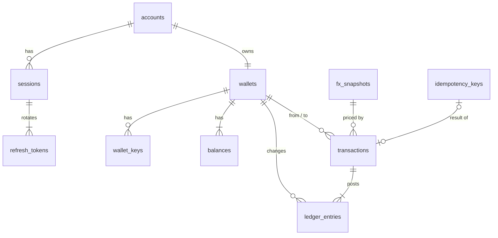

# Borderless

Borderless is the backend for a stablecoin cross-border payment sandbox. It is a REST API
for multi-currency wallets that hold five mock stablecoins: cNGN, cGHS, cXAF, USDx and EURx.
A client can create a wallet, deposit, swap between stablecoins at live FX rates, send money
to another wallet, and read balances, history and rates. There is no frontend.

The name comes from the brief, "Operation Borderless": money that moves between Lagos, Accra
and Douala as easily as inside one wallet.

## Tech stack

| Area        | Choice                                                                                                |
| ----------- | ----------------------------------------------------------------------------------------------------- |
| Language    | Node.js 24 LTS, TypeScript in strict mode                                                             |
| Framework   | NestJS 12, ES modules                                                                                 |
| Database    | PostgreSQL 17                                                                                         |
| Data access | TypeORM 1.1 with hand-written migrations; raw SQL with `$n` parameters on the money path              |
| FX rates    | ExchangeRate-API (primary) and Currency API (secondary), free daily feeds                             |
| Auth        | Account sessions (argon2id passwords, ES256 JWT with rotating refresh tokens) and per-wallet API keys |
| Encryption  | HTTPS through a Caddy proxy with HSTS; AES-256-GCM for email and phone at rest                        |
| Tests       | Vitest and Supertest, against a real PostgreSQL started by Testcontainers                             |
| Tooling     | Yarn 4, ESLint, Prettier, GitHub Actions                                                              |
| Runtime     | Docker and docker compose                                                                             |

## Why PostgreSQL

The hard rules here are about money: a balance never goes negative, a request never changes
money twice, and parallel requests still add up. I wanted the database itself to enforce
those rules, not only the code. PostgreSQL gives me:

- transactions across several rows, and `SELECT ... FOR UPDATE` row locks;
- `CHECK` constraints (`amount >= 0`, the shape of each transaction type) and unique keys;
- exact `bigint` and `numeric` types, so no float ever stores money;
- `INSERT ... ON CONFLICT DO NOTHING` to claim an idempotency key without a race;
- triggers that make the transaction and ledger tables append-only.

The data is relational (accounts, wallets, balances, transactions, ledger lines), so a
document store would have meant rebuilding these guarantees by hand. More detail is in
[ADR-002](docs/decisions/ADR-002-postgresql.md) and the
[database design](docs/database-design.md).

There is no Redis or queue. Rates are cached in memory and refreshed by a timer, and every
money write is one short database transaction, so nothing needed one yet
([ADR-005](docs/decisions/ADR-005-no-redis.md)).

## Setup and run

You need Docker. Then:

```bash
docker compose up --build
```

This starts PostgreSQL, runs the migrations, starts the API, and puts a Caddy HTTPS proxy in
front of it. Migrations run on every start, so there is no separate step. Only the proxy is
reachable from your machine:

| URL                                              | What                   |
| ------------------------------------------------ | ---------------------- |
| `https://localhost:8443/docs`                    | Swagger UI             |
| `https://localhost:8443/docs-json`               | OpenAPI document       |
| `https://localhost:8443/health`, `/health/ready` | Liveness and readiness |
| `http://localhost:8080`                          | Redirects to HTTPS     |

The certificate comes from Caddy's own local authority, so the browser warns once. Use
`curl -k` for a quick look, or trust the local root:

```bash
docker compose cp proxy:/data/caddy/pki/authorities/local/root.crt ./caddy-root.crt
```

Ports are set with `HTTPS_PORT` and `HTTP_PORT`. Every setting is listed, with its meaning,
in `.env.example`. The compose file works without a `.env`.

Live rates need internet access. To demo offline, run `FX_FIXED_TABLE=true docker compose up`:
when both live sources fail, the API prices with a built-in table and marks every such answer
`fixed-table`.

## Tests

You need Node.js 24 and Docker. The repo ships its own Yarn (4.18.1), so any `yarn` on your
path uses it; with none, run `corepack enable` first.

```bash
yarn install
yarn test
```

`yarn test` runs the unit tests, then starts a throwaway PostgreSQL with Testcontainers for
the integration and API tests. The API tests send real HTTP requests through the whole Nest
pipeline. They cover parallel requests against one balance, opposite transfers at the same
time, retries with the same key, and FX providers that fail, lie or go stale. After the money
tests, a check confirms that the ledger lines add up to every balance.

Other checks:

```bash
yarn lint
yarn format:check
yarn typecheck
./scripts/smoke-tls.sh
```

CI runs the first three, `yarn test`, the build and a Docker image build on every push to
`main` and every pull request.
`smoke-tls.sh` checks a running compose stack: HTTPS, HSTS, the HTTP redirect, and that
only TLS 1.2 and 1.3 are accepted. `scripts/load-test.mjs` runs reads, deposits and transfers
in parallel and then checks that no money moved by mistake; the results and how to run it are
in [load test](docs/load-test.md).

The OpenAPI document is committed at [`docs/openapi.json`](docs/openapi.json). It is generated
from the code, and a test fails if the two differ. After changing a route, run `yarn openapi`
to rewrite it.

## Walkthrough of the main endpoints

The API routes are under `https://localhost:8443/api/v1`. Every answer uses one envelope:

```json
{
  "success": true,
  "statusCode": 201,
  "message": "Deposit completed",
  "data": {},
  "requestId": "87b5779d-cf10-4614-aa23-e24aa5ca1e8b",
  "timestamp": "2026-10-29T13:56:57.571Z"
}
```

Errors use the same outer shape with `success: false`, a stable `code` and a plain `message`.
Below I show only `data`. The values come from a local run, shortened where marked and with
a simpler email.

### Create a wallet

```bash
curl -k https://localhost:8443/api/v1/wallets \
  -H 'Content-Type: application/json' \
  -d '{"email":"ada@example.com","password":"correct horse battery staple"}'
```

`201`. The wallet starts with a zero balance in each stablecoin, and the answer signs the
holder in:

```json
{
  "walletId": "53a61348-34a2-44f2-9be9-3a87e7a81e88",
  "email": "ada@example.com",
  "phoneNumber": null,
  "balances": [
    { "currency": "cNGN", "amount": "0.000000", "usdValue": "0.000000" },
    "... cGHS, cXAF, USDx, EURx ..."
  ],
  "totalUsd": "0.000000",
  "rates": {
    "source": "exchangerate-api",
    "asOf": "2026-10-29T00:02:31.000Z",
    "unavailableReason": null
  },
  "createdAt": "2026-10-29T13:56:57.501Z",
  "session": {
    "tokenType": "Bearer",
    "accessToken": "…",
    "refreshToken": "…",
    "...": "expiry times"
  }
}
```

Keep the wallet ID and the access token for the next calls:

```bash
WALLET=<data.walletId>
TOKEN=<data.session.accessToken>
```

A phone number works too (`"phoneNumber": "+233241234567"`). Create a second wallet that way
and keep its ID as `FRIEND` for the transfer below. Each email and each phone number can own
one wallet; a second one gets `409 WALLET_ALREADY_EXISTS`. Later sign-ins use
`POST /auth/login`, and `POST /auth/refresh` swaps a refresh token for a new pair.

Every other route needs `Authorization: Bearer <accessToken>` or a wallet key
(`X-Wallet-Key`, created with `POST /wallets/{walletId}/keys`). Someone else's wallet answers
`404`, exactly like a wallet that doesn't exist.

### Deposit

```bash
curl -k https://localhost:8443/api/v1/wallets/$WALLET/deposits \
  -H "Authorization: Bearer $TOKEN" -H 'Content-Type: application/json' \
  -H 'Idempotency-Key: 7b0c3e9a-4d1f-4c62-9a55-2f9e1b7c0d11' \
  -d '{"currency":"USDx","amount":"100"}'
```

`201`:

```json
{
  "transaction": {
    "transactionId": "04a65608-72c6-4a9b-89f7-9fd1fbdcae4b",
    "type": "DEPOSIT",
    "status": "COMPLETED",
    "fromWalletId": null,
    "toWalletId": "53a61348-34a2-44f2-9be9-3a87e7a81e88",
    "fromCurrency": null,
    "fromAmount": null,
    "toCurrency": "USDx",
    "toAmount": "100.000000",
    "rate": "1.0000000000",
    "rateSource": "none",
    "rateAsOf": null,
    "feeBps": 0,
    "feeAmount": "0.000000",
    "roundingAmount": "0.000000",
    "createdAt": "2026-10-29T13:56:57.567Z"
  },
  "balances": [{ "currency": "USDx", "amount": "100.000000" }]
}
```

Sending the same request again with the same key returns this same answer with the header
`Idempotent-Replayed: true`, and the balance stays at 100.

### Swap

```bash
curl -k https://localhost:8443/api/v1/wallets/$WALLET/swaps \
  -H "Authorization: Bearer $TOKEN" -H 'Content-Type: application/json' \
  -H "Idempotency-Key: $(uuidgen)" \
  -d '{"fromCurrency":"USDx","toCurrency":"cNGN","amount":"10"}'
```

`201`:

```json
{
  "transaction": {
    "type": "SWAP",
    "fromCurrency": "USDx",
    "fromAmount": "10.000000",
    "toCurrency": "cNGN",
    "toAmount": "13395.057035",
    "rate": "1346.2368880000",
    "rateSource": "exchangerate-api",
    "rateAsOf": "2026-10-29T00:02:31.000Z",
    "feeBps": 50,
    "feeAmount": "0.050000",
    "roundingAmount": "0.000000",
    "...": "IDs and time"
  },
  "balances": [
    { "currency": "USDx", "amount": "90.000000" },
    { "currency": "cNGN", "amount": "13395.057035" }
  ]
}
```

### Transfer

```bash
curl -k https://localhost:8443/api/v1/transfers \
  -H "Authorization: Bearer $TOKEN" -H 'Content-Type: application/json' \
  -H "Idempotency-Key: $(uuidgen)" \
  -d '{"fromWalletId":"'$WALLET'","toWalletId":"'$FRIEND'","fromCurrency":"USDx","toCurrency":"cGHS","amount":"25"}'
```

`201`. The receiver gets cGHS at the current rate. The answer shows only the sender's own
balance:

```json
{
  "transaction": {
    "type": "TRANSFER",
    "fromWalletId": "53a61348-34a2-44f2-9be9-3a87e7a81e88",
    "toWalletId": "555a8bcf-f4ff-406b-85f7-ba322d19ebc5",
    "fromCurrency": "USDx",
    "fromAmount": "25.000000",
    "toCurrency": "cGHS",
    "toAmount": "289.542910",
    "rate": "11.6399160000",
    "feeBps": 50,
    "feeAmount": "0.125000",
    "...": "source, rate time, rounding, IDs and time"
  },
  "balances": [{ "currency": "USDx", "amount": "65.000000" }]
}
```

Leave out `toCurrency` to send the same currency. Instead of `toWalletId` you can send
`toEmail` or `toPhoneNumber` to reach the wallet registered with it
([ADR-017](docs/decisions/ADR-017-send-to-email-or-phone.md)); an unknown address answers like
an unknown wallet. Asking for more than the balance:

```json
{
  "success": false,
  "statusCode": 422,
  "error": "Unprocessable Entity",
  "code": "INSUFFICIENT_FUNDS",
  "message": "The USDx balance is too low for this.",
  "details": {
    "currency": "USDx",
    "available": "65.000000",
    "requested": "1000.000000"
  },
  "requestId": "a74c409d-1ea2-4f20-adb0-64926179f546",
  "path": "/api/v1/transfers",
  "timestamp": "2026-10-29T13:56:57.593Z"
}
```

### Quote first, then pay exactly that

```bash
curl -k https://localhost:8443/api/v1/quotes \
  -H "Authorization: Bearer $TOKEN" -H 'Content-Type: application/json' \
  -d '{"fromCurrency":"USDx","toCurrency":"cGHS","amount":"25"}'
```

`201` with the fee, the exact amount that will arrive and when the price expires (30 seconds).
Nothing moves yet. Send the same transfer with `"quoteId": "<quoteId>"` to get exactly that
amount, even if the rates refresh in between. A quote is used once, only by the account that
asked for it, and only for the same currencies and amount
([ADR-015](docs/decisions/ADR-015-quotes.md)).

### Balances

`GET /wallets/{walletId}/balances` → `200`:

```json
{
  "walletId": "53a61348-34a2-44f2-9be9-3a87e7a81e88",
  "balances": [
    { "currency": "cNGN", "amount": "13395.057035", "usdValue": "9.949999" },
    { "currency": "USDx", "amount": "65.000000", "usdValue": "65.000000" },
    "... the other three at 0 ..."
  ],
  "totalUsd": "74.949999",
  "rates": {
    "source": "exchangerate-api",
    "asOf": "2026-10-29T00:02:31.000Z",
    "unavailableReason": null
  }
}
```

USD values round down per balance. The 10 USDx swapped to cNGN shows as 9.949999: 0.05 went
to the fee, and the conversion back rounds down.
Without a fresh rate, `usdValue` and `totalUsd` are `null` and `unavailableReason` says why.

### History

`GET /wallets/{walletId}/transactions?limit=2&type=SWAP,TRANSFER` → `200`:

```json
{
  "items": [
    {
      "type": "TRANSFER",
      "direction": "OUT",
      "fromAmount": "25.000000",
      "toAmount": "289.542910",
      "...": ""
    },
    {
      "type": "SWAP",
      "direction": "INTERNAL",
      "fromAmount": "10.000000",
      "toAmount": "13395.057035",
      "...": ""
    }
  ],
  "page": 1,
  "limit": 2,
  "total": 2
}
```

Newest first. `page` (default 1) and `limit` (default 20, at most 100) page through it;
`type` and `currency` take one value or a comma list. `currency` matches either side of a
transaction. `GET /transactions/{transactionId}` returns one transaction to its sender or
receiver; anyone else gets `404`.

### Rates

`GET /fx/rates` (no sign-in) → `200`:

```json
{
  "base": "USDx",
  "source": "exchangerate-api",
  "isStale": false,
  "providerUpdatedAt": "2026-10-29T00:02:31.000Z",
  "fetchedAt": "2026-10-29T13:53:57.221Z",
  "pairs": [
    {
      "from": "cNGN",
      "to": "cGHS",
      "rate": "0.0086462614",
      "refreshedAt": "2026-10-29T00:02:31.000Z"
    },
    "... 20 pairs in all ..."
  ],
  "attribution": "Rates by Exchange Rate API (https://www.exchangerate-api.com)"
}
```

Rates by [Exchange Rate API](https://www.exchangerate-api.com), with the
[Currency API](https://github.com/fawazahmed0/exchange-api) (CC0) as the second source.

Swagger UI lists every route with its request body, answers and errors.

## Data model



| Table                                       | What it holds                                                                                                                                       |
| ------------------------------------------- | --------------------------------------------------------------------------------------------------------------------------------------------------- |
| `accounts`                                  | The holder: email and phone encrypted, with an HMAC lookup column so each stays unique; argon2id password hash; failed-login counter and lock time. |
| `wallets`                                   | One per account.                                                                                                                                    |
| `balances`                                  | One row per wallet and stablecoin, `bigint` millionths, `CHECK (amount >= 0)`.                                                                      |
| `transactions`                              | Every deposit, swap and transfer: both wallets, both currencies and amounts, the rate, its source and time. `CHECK`s enforce each type's shape.     |
| `ledger_entries`                            | One line per balance change, linked to its transaction. The lines for a wallet and currency always add up to its balance.                           |
| `fx_snapshots`                              | Each provider answer that passed the checks, with the provider's update time.                                                                       |
| `idempotency_keys`                          | The key, a hash of the request and the stored answer, per account, kept for 24 hours.                                                               |
| `sessions`, `refresh_tokens`, `wallet_keys` | Sign-in state. Refresh tokens and wallet keys are stored only as SHA-256 hashes.                                                                    |

`transactions` and `ledger_entries` are append-only: a trigger refuses `UPDATE` and `DELETE`.

## Events and notifications

Every deposit, swap and transfer writes events in the same database transaction as the money:
`deposit.completed`, `swap.completed`, `transfer.sent`, `transfer.received`, and `balance.low`
when a debit takes a balance below 10 USD of value. A worker inside the API delivers them
about once a second as in-app notices:

```bash
curl -k "https://localhost:8443/api/v1/wallets/$WALLET/notifications?unread=true" \
  -H "Authorization: Bearer $TOKEN"
```

A failed delivery is retried with full-jitter backoff, up to 10 times, and then parked for an
operator; each event shows up at most once as a notice. Email and SMS notices aren't built,
because they need an SMTP server or SMS provider
([ADR-016](docs/decisions/ADR-016-outbox-and-notifications.md)).

## Operations

Two operator routes sit behind their own token (`X-Ops-Token`, from `OPS_TOKEN`). Wallet
sessions and keys can't use them, and with no token set they answer `404`. The compose stack
ships a local-only token:

```bash
curl -k https://localhost:8443/api/v1/ops/metrics \
  -H 'X-Ops-Token: local-ops-token-for-the-compose-stack-only'
curl -k https://localhost:8443/api/v1/ops/ledger-check \
  -H 'X-Ops-Token: local-ops-token-for-the-compose-stack-only'
```

- `metrics` is Prometheus text built inside the API: requests and latency by route template,
  money movements, idempotent replays, database conflict retries, FX refresh outcomes and rate
  age, the last ledger check, and process CPU, memory and event-loop lag. No outside service
  is involved.
- `ledger-check` compares every balance with the sum of its ledger lines in one consistent
  snapshot and lists any that differ. It also runs every hour and logs an error if it finds
  one.

See [ADR-013](docs/decisions/ADR-013-ops-metrics-ledger-check.md).

## How I handled the hard parts

Full detail is in [money handling](docs/money-handling.md). In short:

### Money precision

- Every stablecoin has 6 decimal places. Amounts are stored as `bigint` millionths and handled
  as `BigInt` in TypeScript; they never pass through a JavaScript `number`.
- The API takes amounts as decimal strings (`"10.5"`) and refuses JSON numbers and more than
  6 decimals, instead of rounding them.
- A cross rate is computed exactly with integers, then rounded half-even to 10 decimals. That
  10-decimal rate is stored on the transaction and is what the client sees.
- Swaps and cross-currency transfers pay a 0.5% fee, taken from the amount sent and rounded up
  to the next millionth. Same-currency transfers and deposits are free. Fees and any whole
  millionths left over by rounding go to a platform account
  ([ADR-014](docs/decisions/ADR-014-fees-and-platform-account.md)).
- Converted amounts round down, so a swap or transfer can never create money. A conversion
  worth less than 0.000001 is refused with `422 AMOUNT_TOO_SMALL`.
- One operation is capped at 1,000,000,000 units, and a credit that would overflow a balance
  is refused with `422 BALANCE_LIMIT`.

### Idempotency

- Deposits, swaps and transfers need an `Idempotency-Key` header.
- The key is claimed with `INSERT ... ON CONFLICT DO NOTHING` as the first step inside the
  same database transaction that moves the money. The money and the key commit together or
  not at all, so there is no window where one exists without the other.
- A repeat that arrives while the first is still running waits for it. If the first committed,
  the repeat gets the stored answer (`Idempotent-Replayed: true`). If the first failed, the
  repeat runs itself.
- The same key with a different body gets `422 IDEMPOTENCY_KEY_REUSED`. Keys are per
  account and expire after 24 hours.

### Concurrency

- Every balance change goes through one `LedgerService` inside one transaction. It locks the
  balance rows with `SELECT ... FOR UPDATE`, always in the same order (wallet ID, then
  currency), checks funds on the locked rows, then writes.
- The fixed lock order means two opposite transfers (A to B and B to A) can't deadlock. A test
  fires them in parallel, and another fires ten transfers at one balance that can only afford
  some of them.
- A deadlock or serialization failure, which the lock order should prevent, is retried by the
  server up to twice with full-jitter exponential backoff (20 ms base, 200 ms cap). The whole
  transaction reruns, idempotency claim included, so money still moves once. If it keeps
  failing, or a lock isn't free within 3 seconds, the answer is `503 SERVICE_BUSY` and a retry
  is safe ([ADR-012](docs/decisions/ADR-012-retry-policies.md)).
- `CHECK (amount >= 0)` in the database is the last guard if the code is ever wrong.

### FX rate failures

- Rates come from two free daily sources. A background job fetches the primary on start, then
  shortly after its published next update. Requests never call a provider, so a slow provider
  can't slow the API.
- Rates count as fresh for 26 hours after the provider's own update time (one daily cycle plus
  2 hours' grace). With no fresh rate, swaps and transfers get `503 FX_RATE_UNAVAILABLE` and
  nothing moves. Deposits and reads keep working, and `GET /fx/rates` shows the last rates
  with `isStale: true`.
- If the primary fails or is stale, the secondary is used. Each answer is checked: all five
  currencies present, positive finite numbers, and an update time that isn't in the future.
- A rate that moves more than 20% from the current one, or the first rates when none are
  stored yet, is accepted only when the other source agrees within 2%. One broken feed can't
  reprice every wallet. If the other source is down at the very first start, a single answer
  that passes the checks is used.
- Fetches have a 3-second timeout, limited retries with jitter, a 1 MB body cap and no
  redirects. A `429` from the primary means waiting 30 minutes before asking again.
- Every transaction stores the rate, its source and the provider's time, so any conversion
  can be traced back.

## Assumptions

- A wallet needs an email or a phone number, or both. Each is unique on its own. Phone numbers
  without a country code are read as Nigerian (+234).
- Each stablecoin is worth 1 unit of its fiat currency, so FX comes from fiat rates.
- All five stablecoins use 6 decimal places.
- Deposits are simulated: instant, and they always succeed.
- Conversions pay a 0.5% fee by default, and converted amounts round down. There are no spreads.
- Daily reference rates count as "current" rates for a sandbox.
- A wallet can't transfer to itself; a swap does that job.
- I added sign-in (accounts, sessions and wallet keys) although the brief doesn't ask for it.
  A money API where anyone can move anyone's balance by guessing an ID didn't feel honest to
  submit. See [authentication](docs/authentication.md).

## Known limitations

- **Rates are daily reference rates, not market prices.** The free sources publish once a day,
  so a swap at 23:00 uses that morning's rate.
- **The primary rate source doesn't allow republishing its rates.** ExchangeRate-API's open
  endpoint allows caching and currency conversion, but its terms forbid redistribution and
  use in any service that offers programmatic access to rates, which `GET /fx/rates` does. I
  kept it for this non-commercial sandbox because the brief asks for a rates endpoint. A real
  launch needs a feed licensed for republishing, or only the secondary source, which is CC0.
  Details are in [money handling](docs/money-handling.md#provider-choice).
- **The last fraction of a millionth isn't booked.** Fees and whole leftover millionths go to the
  platform account, but the part of a conversion below one millionth of the source currency
  is not recorded anywhere.
- **History uses offset paging.** A client walking every page while a slow write commits could
  see one item twice or miss one.
- **Idempotency compares the body value for value.** Key order and spacing don't matter, but a
  retry that rewrites a value (for example `"20.0"` instead of `"20"`) gets
  `422 IDEMPOTENCY_KEY_REUSED`, not a replay.
- **No message-level encryption.** TLS protects every body in transit; signed or encrypted
  bodies (JWS or JWE) add nothing for this API today. The reasons and when I'd add them are
  in [ADR-009](docs/decisions/ADR-009-encryption.md).
- **A taken email or phone shows up as taken.** The brief requires refusing a second wallet for
  the same identifier, so `POST /wallets` answers `409` for it. A transfer to an email or phone
  also shows whether it has a wallet. Wallet creation is limited to 10 a minute per IP and money
  routes to 30, to slow down anyone checking lists of addresses.
- **One API instance.** The FX refresh job and the in-memory rate limiter assume one process.
- **Local only.** There is no hosted deployment; the brief doesn't ask for one.

## Left out on purpose

- A frontend or admin portal (the brief says no frontend).
- Email or SMS verification, password reset, MFA and roles.
- Real payment rails, withdrawals, custody, KYC and any blockchain.
- Spreads, and daily or monthly limits.
- Sending to someone who has no wallet yet, and email or SMS notices. Both need an SMTP server
  or SMS provider to reach the person.

## With more time

- Cursor paging for history, so walking every page is exact.
- A paid, intraday FX feed for real pricing, with the same two-source check.
- Redis for the rate limiter and a lock for the FX job, so several API instances can run.
- Email or SMS notices. They need an SMTP server or an SMS provider; the outbox already has the
  events, so each would be one more handler.
- Metrics and alerts on stale rates and lock timeouts, and a load test on separate machines.

## Documents

| Document                                                           | What it covers                                                 |
| ------------------------------------------------------------------ | -------------------------------------------------------------- |
| [Project statement](docs/project-statement.md)                     | The problem, scope, risks and success criteria                 |
| [PRD](docs/prd.md)                                                 | Actors, journeys, user stories and priorities                  |
| [FRD](docs/frd.md)                                                 | Each functional requirement with flows and acceptance criteria |
| [Non-functional requirements](docs/non-functional-requirements.md) | Stack, quality, security and operations requirements           |
| [Architecture](docs/architecture.md)                               | Modules, request flow, diagrams and repository layout          |
| [API specification](docs/api-specification.md)                     | Endpoints, request and response shapes, error format           |
| [OpenAPI](docs/openapi.json)                                       | The machine-readable contract, generated from the code         |
| [Database design](docs/database-design.md)                         | Tables, constraints, indexes and migrations                    |
| [Authentication](docs/authentication.md)                           | Accounts, sessions, wallet keys and who may call what          |
| [Money, idempotency, concurrency and FX](docs/money-handling.md)   | Precision, rounding, locking, retries and rate failures        |
| [Security review](docs/security-review.md)                         | Threat model and the control for each threat                   |
| [Test strategy](docs/test-strategy.md)                             | Unit, integration, API, concurrency and contract tests         |
| [Load test](docs/load-test.md)                                     | Throughput, latency and money checks under parallel load       |
| [Requirements traceability](docs/requirements-traceability.md)     | Brief → requirement → component → test → evidence              |
| [Delivery plan](docs/plan.md)                                      | The 48-hour schedule, assumptions, risks and open decisions    |
| [Pre-launch checklist](docs/checklists/pre-launch-checklist.md)    | Every check, marked mandatory, recommended or not applicable   |
| [Decisions](docs/decisions/)                                       | Architecture decision records                                  |
