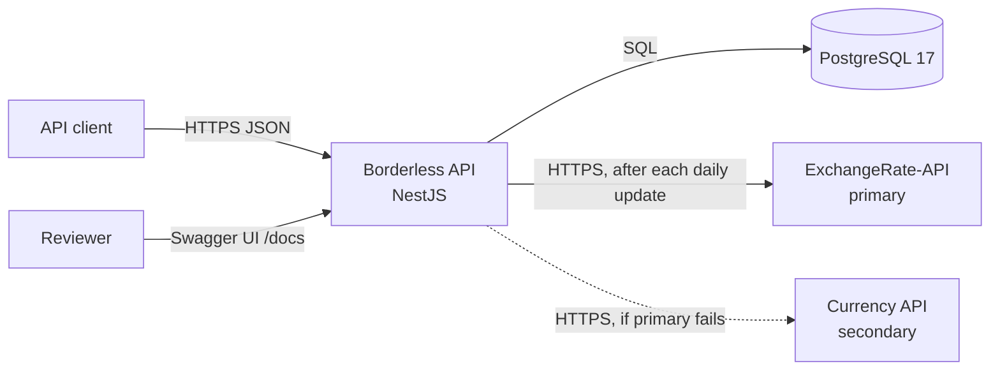
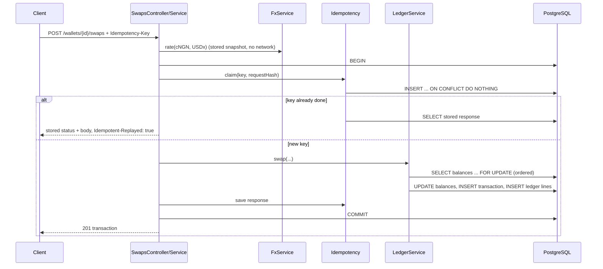
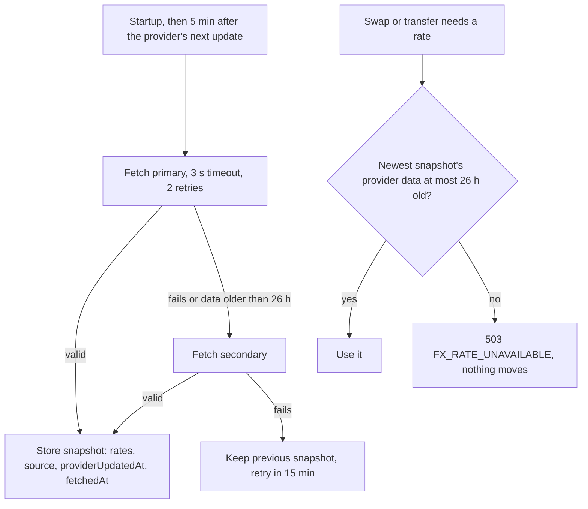

# Architecture

## Shape

A NestJS modular monolith with one PostgreSQL database. One app keeps a whole money
movement inside one database transaction; separate services would put network calls between
the steps. No cache or queue: PostgreSQL row locks and unique constraints give the guarantees
we need, the FX snapshot lives in the database, and the two background jobs (rate refresh,
key cleanup) run in-process with `@nestjs/schedule`. The brief allows Redis or a queue only
where it earns its place; here it would add a second source of truth for rates and nothing
to process ([ADR-001](decisions/ADR-001-modular-monolith.md),
[ADR-005](decisions/ADR-005-no-redis.md)).

## System context



Trust boundaries: the client is untrusted (authenticated, but all input validated and
ownership checked); the FX provider is
untrusted (every response validated before use); the database is trusted.

## Modules

| Module | Responsibility |
| --- | --- |
| `config` | Loads and validates environment variables at startup. |
| `database` | TypeORM data source, migrations, `runInTransaction` helper, naming strategy. |
| `common` | Error filter and error codes, request ID middleware, validation pipe, money helpers (`Money`, parse/format), pagination DTOs. |
| `currencies` | The five supported stablecoins, their fiat pegs and decimals. Pure code, no table. |
| `fx` | `FxProvider` interface, primary and secondary adapters, snapshot store, refresh scheduler, `FxService.rate(from, to)`, `GET /fx/rates`. |
| `auth` | Accounts, argon2id passwords, login, JWT access tokens, refresh rotation, logout, wallet keys, the auth guard and the ownership check. |
| `wallets` | Create and read wallets and balances, USD total. |
| `ledger` | `LedgerService`: the only code that changes balances. Locks rows, checks funds, writes transaction + ledger lines. |
| `deposits`, `swaps`, `transfers` | Thin controllers and services that validate, price, and call `LedgerService` inside an idempotent transaction. |
| `transactions` | History list with filters and pagination, transaction by ID. |
| `idempotency` | Claim, replay and conflict logic on `idempotency_keys`; cleanup job. |
| `health` | Liveness and readiness. |

Deposits, swaps and transfers may later merge into one `payments` module if the code is
small; the boundaries above stay the same.

## Money write flow (swap)



If anything throws, the transaction rolls back, including the key claim, so a retry can run
again. A parallel request with the same key blocks on the unique index until the first
commits, then replays it.

## FX refresh flow



## Request lifecycle

1. `helmet`, body size limit, request ID middleware (accepts a safe incoming
   `X-Request-Id` or makes one).
2. Throttler guard (per IP).
3. Auth guard: verifies the JWT (pinned algorithm, `iss`, `aud`, `exp`) and that its session
   isn't revoked, or checks the wallet key; public routes are marked `@Public()`. Services
   then check the caller owns the wallet.
4. Validation pipe: `whitelist`, `forbidNonWhitelisted`, `transform`.
5. Controller → service → `LedgerService` / repositories.
6. Global error filter maps known errors to codes; anything else becomes a generic `500`
   with the request ID, and the real error is logged.

## Error handling

- Domain errors are `AppError(code, message, details?)`; the code decides the status
  ([api-specification.md](api-specification.md#errors)).
- PostgreSQL errors: `23505` unique → `409` where expected (wallet identifiers), `23514`
  check violation → `422 INSUFFICIENT_FUNDS` (last guard), lock or statement timeout → `503`.
- Database text never reaches the client.

## Deployment topology

`docker compose up` starts two services:

| Service | Image | Notes |
| --- | --- | --- |
| `db` | `postgres:17-alpine` | Health check `pg_isready`; data in a named volume. |
| `api` | Built from `Dockerfile` (Node 24, multi-stage, non-root) | Waits for `db` healthy, runs migrations, then starts. Port 3000. |

## Repository layout (planned)

```
operation-borderless/
├── src/
│   ├── main.ts, app.module.ts, app.setup.ts
│   ├── config/  database/  common/  currencies/
│   ├── auth/  fx/  wallets/  ledger/  idempotency/
│   ├── deposits/  swaps/  transfers/  transactions/  health/
│   └── migrations/
├── test/
│   ├── unit/            pure functions and services with fakes
│   ├── integration/     services against real PostgreSQL
│   ├── api/             Supertest through the full Nest app
│   └── support/         Testcontainers setup, factories, fake FX provider
├── docs/                these documents, plus openapi.json
├── Dockerfile, docker-compose.yml, .env.example
├── .github/workflows/ci.yml
└── package.json, yarn.lock, tsconfig.json, eslint and prettier config
```

## Trade-offs

| Choice | Gain | Cost |
| --- | --- | --- |
| Pessimistic row locks | Simple, provably correct, no retry loops | Hot wallets serialise; fine for a sandbox |
| FX read from stored snapshot | Requests never hang on a provider | Rates are daily reference rates, not live market prices |
| Fail closed on stale rates | Money never moves on an old rate | Swaps and transfers stop if both sources are down for over 2 h past a publication |
| Auth added beyond the brief | Only owners move money | ~8 h of work; reviewers copy a token once |
| Session check per request | Logout is immediate | One indexed read per request |
| Offset pagination | Simple, gives `total` | Slower on deep pages; cursor noted as future work |
