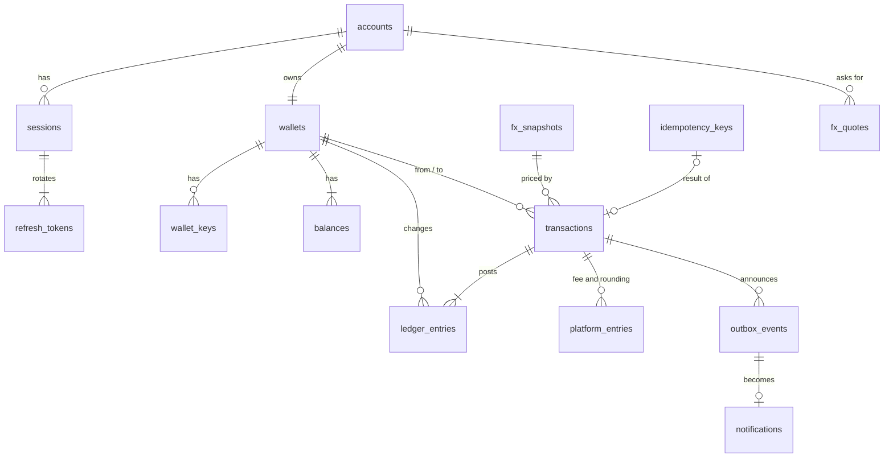

# Database Design

PostgreSQL 17. Names are snake_case. IDs are UUIDs from `gen_random_uuid()`. All times are
`timestamptz`.

## Why PostgreSQL

Balances must never go negative, never change twice for one request, and stay correct under
parallel requests. PostgreSQL gives ACID transactions across several rows, `SELECT ... FOR
UPDATE` row locks, `CHECK` and unique constraints that enforce the rules in the database
itself, exact `bigint` and `numeric` types, `INSERT ... ON CONFLICT` for race-free
idempotency claims, and triggers for append-only tables. MySQL would also work but has no
`ON CONFLICT ... RETURNING`; MongoDB's constraints and locking are weaker and this data is
relational ([ADR-002](decisions/ADR-002-postgresql.md)).

Data access is TypeORM with `synchronize` off and migrations written by hand. Raw SQL with
`$n` parameters is used where it is clearer (ordered locks, `ON CONFLICT`). See [ADR-003](decisions/ADR-003-typeorm.md).

## Entity relationships

## Tables

### `accounts`

| Column            | Type             | Rules                                                                 |
| ----------------- | ---------------- | --------------------------------------------------------------------- |
| `id`              | uuid PK          |                                                                       |
| `email_encrypted` | bytea null       | AES-256-GCM of the normalised email: key version, IV, ciphertext, tag |
| `email_lookup`    | bytea null       | HMAC-SHA256 of the normalised email. Unique where not null.           |
| `phone_encrypted` | bytea null       | Same, for the E.164 number                                            |
| `phone_lookup`    | bytea null       | HMAC-SHA256 of the E.164 number. Unique where not null.               |
| `pii_key_version` | smallint         | Key version used, for rotation                                        |
| `password_hash`   | text             | argon2id encoded string                                               |
| `failed_logins`   | int              | default 0                                                             |
| `locked_until`    | timestamptz null |                                                                       |
| `created_at`      | timestamptz      |                                                                       |

`CHECK (email_lookup IS NOT NULL OR phone_lookup IS NOT NULL)`. The identifiers live here,
so the "one wallet per email or number" rule is the unique lookup indexes plus
`wallets.account_id` being unique. The encryption uses the account ID and field name as
associated data, so a ciphertext copied to another row or column fails to decrypt
([ADR-009](decisions/ADR-009-encryption.md)).

### `sessions`

| Column           | Type             | Rules                                              |
| ---------------- | ---------------- | -------------------------------------------------- |
| `id`             | uuid PK          | the `sid` claim                                    |
| `account_id`     | uuid FK          | indexed                                            |
| `created_at`     | timestamptz      |                                                    |
| `revoked_at`     | timestamptz null | set by logout or refresh reuse                     |
| `revoked_reason` | text null        | `LOGOUT`, `LOGOUT_ALL`, `REFRESH_REUSE`            |
| `expires_at`     | timestamptz      | Login time + 90 days; after it the session is dead |

### `refresh_tokens`

| Column       | Type             | Rules           |
| ------------ | ---------------- | --------------- |
| `id`         | uuid PK          |                 |
| `session_id` | uuid FK          | indexed         |
| `token_hash` | text             | SHA-256, unique |
| `expires_at` | timestamptz      |                 |
| `used_at`    | timestamptz null | set on rotation |

### `wallet_keys`

| Column                                     | Type        | Rules         |
| ------------------------------------------ | ----------- | ------------- |
| `id`                                       | text PK     | public key ID |
| `wallet_id`                                | uuid FK     | indexed       |
| `name`                                     | text        | 1–60 chars    |
| `secret_hash`                              | text        | SHA-256       |
| `created_at`, `last_used_at`, `revoked_at` | timestamptz |               |

### `wallets`

| Column       | Type               | Rules                           |
| ------------ | ------------------ | ------------------------------- |
| `id`         | uuid PK            |                                 |
| `account_id` | uuid FK → accounts | unique (one wallet per account) |
| `created_at` | timestamptz        | default `now()`                 |

### `balances`

| Column       | Type              | Rules                                                      |
| ------------ | ----------------- | ---------------------------------------------------------- |
| `wallet_id`  | uuid FK → wallets |                                                            |
| `currency`   | text              | `CHECK (currency IN ('cNGN','cGHS','cXAF','USDx','EURx'))` |
| `amount`     | bigint            | Minor units (6 decimals). `CHECK (amount >= 0)`            |
| `updated_at` | timestamptz       |                                                            |

PK `(wallet_id, currency)`. Five rows are created with every wallet.

### `transactions`

| Column            | Type             | Rules                                                     |
| ----------------- | ---------------- | --------------------------------------------------------- |
| `id`              | uuid PK          |                                                           |
| `type`            | text             | `DEPOSIT`, `SWAP`, `TRANSFER`                             |
| `status`          | text             | `COMPLETED` (only state; operations are synchronous)      |
| `from_wallet_id`  | uuid null FK     | null for deposits                                         |
| `to_wallet_id`    | uuid FK          |                                                           |
| `from_currency`   | text null        | null for deposits                                         |
| `from_amount`     | bigint null      | `> 0` when set                                            |
| `to_currency`     | text             |                                                           |
| `to_amount`       | bigint           | `> 0`                                                     |
| `rate`            | numeric(30,10)   | `1` for deposits and same-currency transfers              |
| `rate_source`     | text             | `none`, `exchangerate-api`, `currency-api`, `fixed-table` |
| `rate_as_of`      | timestamptz null |                                                           |
| `fx_snapshot_id`  | uuid null FK     |                                                           |
| `fee_bps`         | integer          | 0 to 1000; 0 for deposits and same-currency transfers     |
| `fee_amount`      | bigint           | `>= 0`, in `from_currency`                                |
| `rounding_amount` | bigint           | `>= 0`, whole source millionths kept after rounding down  |
| `created_at`      | timestamptz      |                                                           |

Checks per type: deposit has no `from_*` and no fee; swap has `from_wallet_id = to_wallet_id`
and different currencies; transfer has different wallets. `fee_amount + rounding_amount` is
always below `from_amount`.

Indexes: `(to_wallet_id, created_at DESC)`, `(from_wallet_id, created_at DESC)`.

### `ledger_entries`

| Column           | Type        | Rules                                      |
| ---------------- | ----------- | ------------------------------------------ |
| `id`             | uuid PK     |                                            |
| `transaction_id` | uuid FK     |                                            |
| `wallet_id`      | uuid FK     |                                            |
| `currency`       | text        |                                            |
| `amount`         | bigint      | Signed: credit `> 0`, debit `< 0`; never 0 |
| `balance_after`  | bigint      | `>= 0`                                     |
| `created_at`     | timestamptz |                                            |

Index `(wallet_id, created_at DESC)`, `(transaction_id)`. Deposit = 1 line, swap = 2,
transfer = 2. History is read from `transactions` joined by wallet; ledger lines prove
balances (sum of lines per wallet and currency = `balances.amount`).

### `fx_snapshots`

| Column                | Type        | Rules                                                                  |
| --------------------- | ----------- | ---------------------------------------------------------------------- |
| `id`                  | uuid PK     |                                                                        |
| `source`              | text        | `exchangerate-api`, `currency-api` or `fixed-table`                    |
| `base`                | text        | `USD`                                                                  |
| `rates`               | jsonb       | `{ "NGN": "1346.236888", ... }` as strings, all five present and `> 0` |
| `provider_updated_at` | timestamptz | from the provider                                                      |
| `fetched_at`          | timestamptz |                                                                        |

Index `(source, fetched_at DESC)`. Only the newest live snapshot is used; older rows stay as
history because transactions reference them. Rows older than 30 days and not referenced
could be pruned; that job is not built.

### `idempotency_keys`

| Column           | Type         | Rules                                              |
| ---------------- | ------------ | -------------------------------------------------- |
| `account_id`     | uuid FK      |                                                    |
| `key`            | text         | PK is `(account_id, key)`                          |
| `request_hash`   | text         | sha256 of method + path + canonical body           |
| `status_code`    | int          |                                                    |
| `response_body`  | json         | kept as written, so a replay matches byte for byte |
| `transaction_id` | uuid null FK |                                                    |
| `created_at`     | timestamptz  |                                                    |
| `expires_at`     | timestamptz  | `created_at + 24 h`; index for cleanup             |

The row is inserted in the same transaction as the money movement, so it exists only if the
operation committed.

### `platform_entries` (ADR-014)

| Column           | Type        | Rules                             |
| ---------------- | ----------- | --------------------------------- |
| `id`             | uuid PK     |                                   |
| `transaction_id` | uuid FK     | unique together with `kind`       |
| `currency`       | stablecoin  | the transaction's `from_currency` |
| `kind`           | text        | `fee` or `rounding`               |
| `amount`         | bigint      | `> 0`                             |
| `created_at`     | timestamptz |                                   |

The platform account has no balance row, so collecting fees never makes conversions wait on
one lock; its balance is the sum. Append-only.

### `fx_quotes` (ADR-015)

| Column                                                | Type                 | Rules                            |
| ----------------------------------------------------- | -------------------- | -------------------------------- |
| `id`                                                  | uuid PK              |                                  |
| `account_id`                                          | uuid FK              | the only account that may use it |
| `from_currency`, `to_currency`, `amount`              | stablecoin, bigint   | must match the movement exactly  |
| `rate`, `rate_source`, `rate_as_of`, `fx_snapshot_id` | as on `transactions` | the held price                   |
| `fee_bps`                                             | integer              | the held fee rate                |
| `created_at`, `expires_at`                            | timestamptz          | `expires_at > created_at`        |
| `used_at`                                             | timestamptz null     | set in the money transaction     |

Index `(expires_at)`; rows are deleted an hour after they expire.

### `outbox_events` (ADR-016)

| Column                        | Type             | Rules                                                                                      |
| ----------------------------- | ---------------- | ------------------------------------------------------------------------------------------ |
| `id`                          | uuid PK          |                                                                                            |
| `type`                        | text             | `deposit.completed`, `swap.completed`, `transfer.sent`, `transfer.received`, `balance.low` |
| `wallet_id`, `transaction_id` | uuid FK          |                                                                                            |
| `payload`                     | json             | IDs, currencies and amounts only                                                           |
| `created_at`, `available_at`  | timestamptz      | `available_at` moves forward after a failed delivery                                       |
| `attempts`, `last_error`      | integer, text    |                                                                                            |
| `queued_at`                   | timestamptz null | when the relay last put it in the BullMQ queue                                             |
| `processed_at`, `failed_at`   | timestamptz null | never both                                                                                 |

Partial index on `available_at` for events not yet delivered or parked.

### `notifications` (ADR-016)

| Column                  | Type             | Rules                        |
| ----------------------- | ---------------- | ---------------------------- |
| `id`                    | uuid PK          |                              |
| `wallet_id`             | uuid FK          |                              |
| `event_id`              | uuid FK unique   | a second delivery is a no-op |
| `kind`, `title`, `body` | text             |                              |
| `created_at`            | timestamptz      | when the money moved         |
| `read_at`               | timestamptz null |                              |

Index `(wallet_id, created_at DESC, id DESC)`.

## Append-only

A trigger refuses `UPDATE` and `DELETE` on `transactions` and `ledger_entries`.
`balances` is the only table money operations update.

## Migrations

- TypeORM migrations in `src/migrations/`, written and reviewed by hand, `synchronize` off.
- The API container runs `migration:run` before it starts; `yarn migration:run` does the
  same locally.
- Every migration has a working `down`.
- Tests run migrations on a fresh database, so a broken migration fails `yarn test`.

## Seed data

No seed is required to use the API. `yarn seed` (Could) creates two demo wallets with
deposits for the README walkthrough. The optional fixed FX table is code, not seed data.

## Connections and timeouts

- TLS to PostgreSQL via `DB_SSL` (`disable` locally; `verify-full` required in production).

- Pool size 10. `statement_timeout` 5 s and `lock_timeout` 3 s on each connection; a timeout
  becomes `503 SERVICE_BUSY`. A deadlock or serialization failure is retried twice first
  ([ADR-012](decisions/ADR-012-retry-policies.md)).
- One transaction uses one connection; no outside calls inside a transaction.

## Access

The app uses one database role that owns its schema (sandbox). In production it would use a
role with only `SELECT/INSERT/UPDATE` on these tables and no `DELETE` on money tables
(documented as future work). Row-level security is not used: there are no users or tenants
to separate.
