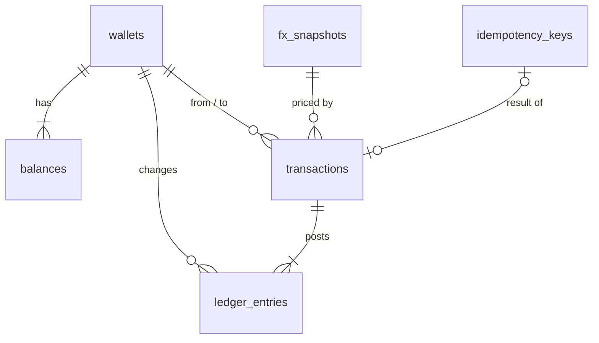

# Database Design

PostgreSQL 17. Names are snake_case. IDs are UUIDs from `gen_random_uuid()`. All times are
`timestamptz`.

## Why PostgreSQL

Balances must never go negative, never change twice for one request, and stay correct under
parallel requests. PostgreSQL gives ACID transactions across several rows, `SELECT ... FOR
UPDATE` row locks, `CHECK` and unique constraints that enforce the rules in the database
itself, exact `bigint` and `numeric` types, `INSERT ... ON CONFLICT` for race-free
idempotency claims, and triggers for append-only tables. MySQL would also work but has no
`ON CONFLICT ... RETURNING`; MongoDB's constraints and locking are weaker and this data is
relational.

Data access is TypeORM with `synchronize` off and migrations written by hand. Raw SQL with
`$n` parameters is used where it is clearer (ordered locks, `ON CONFLICT`).

## Entity relationships

## Tables

### `wallets`

| Column | Type | Rules |
| --- | --- | --- |
| `id` | uuid PK | |
| `email` | text null | Normalised (trimmed, lower case). Unique where not null. |
| `phone_number` | text null | E.164. Unique where not null. |
| `created_at` | timestamptz | default `now()` |

`CHECK (email IS NOT NULL OR phone_number IS NOT NULL)`.

### `balances`

| Column | Type | Rules |
| --- | --- | --- |
| `wallet_id` | uuid FK → wallets | |
| `currency` | text | `CHECK (currency IN ('cNGN','cGHS','cXAF','USDx','EURx'))` |
| `amount` | bigint | Minor units (6 decimals). `CHECK (amount >= 0)` |
| `updated_at` | timestamptz | |

PK `(wallet_id, currency)`. Five rows are created with every wallet.

### `transactions`

| Column | Type | Rules |
| --- | --- | --- |
| `id` | uuid PK | |
| `type` | text | `DEPOSIT`, `SWAP`, `TRANSFER` |
| `status` | text | `COMPLETED` (only state; operations are synchronous) |
| `from_wallet_id` | uuid null FK | null for deposits |
| `to_wallet_id` | uuid FK | |
| `from_currency` | text null | null for deposits |
| `from_amount` | bigint null | `> 0` when set |
| `to_currency` | text | |
| `to_amount` | bigint | `> 0` |
| `rate` | numeric(30,10) | `1` for deposits and same-currency transfers |
| `rate_source` | text | `none`, `exchangerate-api`, `fallback-table` |
| `rate_as_of` | timestamptz null | |
| `fx_snapshot_id` | uuid null FK | |
| `created_at` | timestamptz | |

Checks per type: deposit has no `from_*`; swap has `from_wallet_id = to_wallet_id` and
different currencies; transfer has different wallets.

Indexes: `(to_wallet_id, created_at DESC)`, `(from_wallet_id, created_at DESC)`.

### `ledger_entries`

| Column | Type | Rules |
| --- | --- | --- |
| `id` | uuid PK | |
| `transaction_id` | uuid FK | |
| `wallet_id` | uuid FK | |
| `currency` | text | |
| `amount` | bigint | Signed: credit `> 0`, debit `< 0`; never 0 |
| `balance_after` | bigint | `>= 0` |
| `created_at` | timestamptz | |

Index `(wallet_id, created_at DESC)`, `(transaction_id)`. Deposit = 1 line, swap = 2,
transfer = 2. History is read from `transactions` joined by wallet; ledger lines prove
balances (sum of lines per wallet and currency = `balances.amount`).

### `fx_snapshots`

| Column | Type | Rules |
| --- | --- | --- |
| `id` | uuid PK | |
| `source` | text | `exchangerate-api` or `fallback-table` |
| `base` | text | `USD` |
| `rates` | jsonb | `{ "NGN": "1346.236888", ... }` as strings, all five present and `> 0` |
| `provider_updated_at` | timestamptz | from the provider |
| `fetched_at` | timestamptz | |

Index `(source, fetched_at DESC)`. Only the newest live snapshot is used; older rows stay as
history because transactions reference them. Rows older than 30 days and not referenced
can be pruned (*proposed*, not built unless time allows).

### `idempotency_keys`

| Column | Type | Rules |
| --- | --- | --- |
| `key` | text PK | |
| `request_hash` | text | sha256 of method + path + canonical body |
| `status_code` | int | |
| `response_body` | jsonb | |
| `transaction_id` | uuid null FK | |
| `created_at` | timestamptz | |
| `expires_at` | timestamptz | `created_at + 24 h`; index for cleanup |

The row is inserted in the same transaction as the money movement, so it exists only if the
operation committed.

## Append-only

A trigger refuses `UPDATE` and `DELETE` on `transactions` and `ledger_entries`.
`balances` is the only table money operations update.

## Migrations

- TypeORM migrations in `src/migrations/`, written and reviewed by hand, `synchronize` off.
- The API container runs `migration:run` before it starts; `yarn migration:run` does the
  same locally.
- Every migration has a working `down`.
- Tests run migrations on a fresh database, so a broken migration fails `yarn test`.

## Seed data

No seed is required to use the API. `yarn seed` (Could) creates two demo wallets with
deposits for the README walkthrough. The fallback FX table is code, not seed data.

## Connections and timeouts

- Pool size 10 (*proposed*). `statement_timeout` 5 s and `lock_timeout` 3 s on each
  connection; a timeout becomes `503 SERVICE_BUSY`.
- One transaction uses one connection; no outside calls inside a transaction.

## Access

The app uses one database role that owns its schema (sandbox). In production it would use a
role with only `SELECT/INSERT/UPDATE` on these tables and no `DELETE` on money tables
(documented as future work). Row-level security is not used: there are no users or tenants
to separate.
